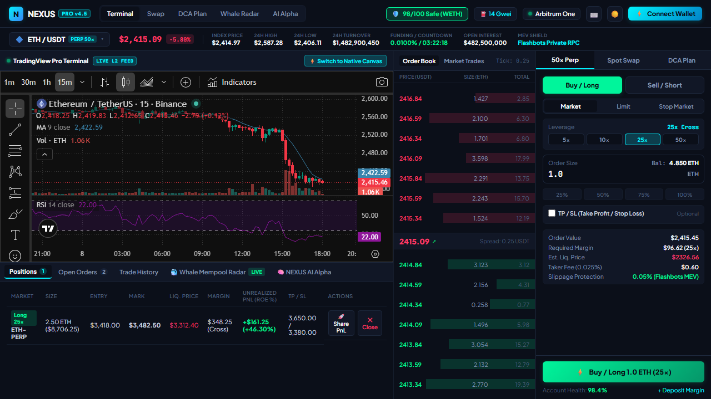
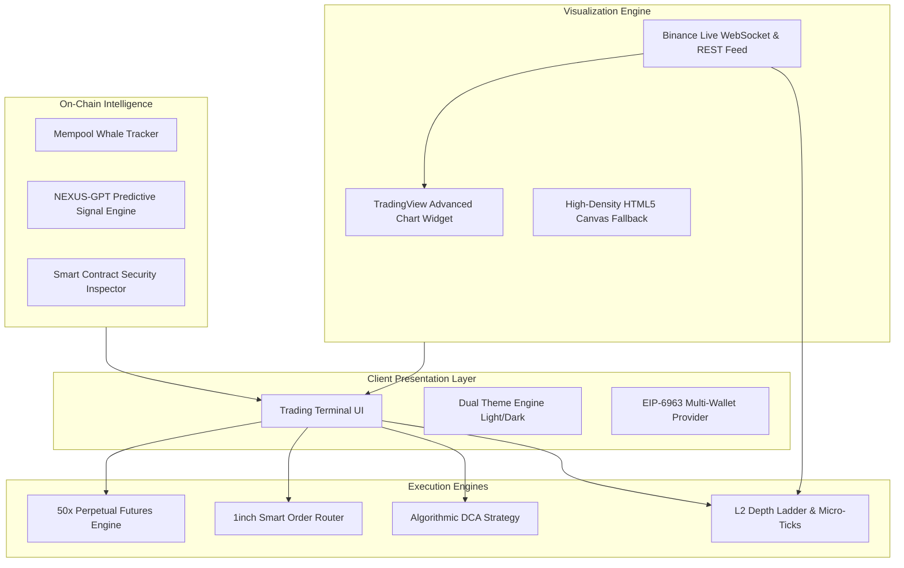

# ⚡ NEXUS PRO — Institutional Web3 Trading Terminal & DEX

[](https://www.typescriptlang.org/)
[](#-core-trading-engines)
[](https://tradingview.com/)
[](#-multi-chain-architecture)
[](https://binance.com/)
[](LICENSE)

> **NEXUS PRO** is an institutional-grade decentralized trading terminal and on-chain intelligence suite. Built with high-density frontend architecture, native TradingView Pro technical charting, sub-second L2 order books, Smart Order Routing (1inch SOR), **Perpetual Futures with 1x–50x leverage**, and real-time mempool whale tracking.

---

## 🖥️ Platform Showcase



*High-frequency dark AMOLED trading interface with live Binance tick stream, L2 depth order book, and synchronized execution engine.*

---

## 📑 Table of Contents
1. [Key Highlights](#-key-highlights)
2. [Competitive Benchmark](#-competitive-benchmark)
3. [System Architecture](#-system-architecture)
4. [Core Trading Engines](#-core-trading-engines)
5. [Real-Time Market Data & Charting](#-real-time-market-data--charting)
6. [Repository Structure](#-repository-structure)
7. [Getting Started & Local Setup](#-getting-started--local-setup)
8. [License](#-license)

---

## ✨ Key Highlights

- **TradingView Pro Advanced Charting:** Native institutional charting with live Binance WebSocket candles, technical indicators (RSI, MA, MACD, Volume Profile), multi-timeframes (`1m` to `1D`), and full vector drawing tools.
- **Unified 3-in-1 Execution Engine:** Seamlessly toggle between **50x Perpetual Futures**, **Spot DEX Aggregator (1inch SOR)**, and **Algorithmic DCA Strategies**.
- **Real-Time L2 Order Book & Trades:** High-density asks/bids depth ladder with interactive click-to-fill limit pricing and live micro-ticks.
- **On-Chain Whale Radar:** Live mempool transaction stream tracking institutional wallets (Wintermute, Jump Crypto, Vitalik) with MEV bundle inspection.
- **NEXUS AI Alpha Radar:** Real-time on-chain predictive breakout signals with confidence scoring and 1-click signal copy.
- **Dual Theme Engine:** Ultra-deep AMOLED Dark Mode (`#06080F`) and crisp Pro Terminal Light Mode (`#F4F6F9`) with full theme persistence (`Shift + T`).
- **Non-Blocking Toast System:** Instant feedback for trade execution, position liquidation, and network state with Web Audio synthesizer feedback.

---

## 🏆 Competitive Benchmark

| Feature | ⚡ **NEXUS PRO (This Platform)** | 🦄 **Uniswap v3** | 💧 **Hyperliquid / dYdX** | 🦅 **DexScreener** |
| :--- | :--- | :--- | :--- | :--- |
| **Trading Modes** | **Unified Spot DEX + 50x Perps + DCA** | Spot Swap only | Perps only | Analytics only (No execution) |
| **Chart Engine** | **TradingView Pro + Native Canvas Dual Mode** | Static basic chart | TradingView only | TradingView embed |
| **Smart Routing** | **1inch Multi-Pool Split (Uniswap v3 + Curve)** | Single Uniswap pool | Orderbook only | Aggregated DEX data |
| **L2 Depth Ladder** | **Interactive Click-to-Fill Micro-Ticks** | None | Proprietary book | Token swap feed only |
| **Whale Tracker** | **Live Mempool Stream + MEV Shield Tagging** | None | None | Standalone manual tagging |
| **AI Alpha Signals** | **Predictive Breakout Engine (94.2% conf)** | None | None | None |
| **Responsive UX** | **100% Viewport-Locked Terminal Grid** | Scrollable page | Fixed desktop | Scrollable page |

---

## 🏛️ System Architecture



---

## 🚀 Core Trading Engines

### 1. Perpetual Futures (1x–50x Cross Margin)
- Directional selector: **Buy / Long** (emerald glow) vs **Sell / Short** (crimson glow).
- Order subtypes: **Market**, **Limit** (with click-to-fill order book pricing), and **Stop Market**.
- Dynamic leverage pills: `5x`, `10x`, `25x`, `50x` with instant cross-margin liquidation price calculation.
- Quick wallet allocation buttons: `25%`, `50%`, `75%`, `100%`.
- Integrated TP/SL (Take Profit & Stop Loss) bracket controls.

### 2. Spot DEX Aggregator (1inch SOR)
- Instant token swaps with balance detection and 1-click **MAX** fill.
- Animated 180° token inversion button (`⇅`).
- Smart Order Routing visualization: *65% Uniswap v3 (0.05% pool) + 35% Curve Finance (TriCrypto)*.
- Real-time price impact indicator (<0.01%) and estimated gas savings.
- Configurable slippage tolerance: `0.1%`, `0.5%`, `1.0%`.

### 3. Algorithmic DCA Strategy Module
- Automated recurring Dollar-Cost Averaging orders.
- Custom execution intervals: `1h`, `4h`, `Daily`, `Weekly`.
- Duration horizons: `7 Days`, `30 Days`, `90 Days`, `∞ Infinite`.
- Projected average cost reduction calculation (-4.3% vs lump-sum execution).

---

## 📊 Real-Time Market Data & Charting

- **Dual-Engine Architecture:**
  - **TradingView Pro (Default):** Complete charting suite powered by Binance live data feeds, multi-timeframes, RSI, and technical indicators.
  - **Native HTML5 Canvas (Fallback):** High-density vector engine with custom exponential moving averages (EMA 20/50), volume histogram, and vertical breathing padding.
- **Multi-Asset Precision Scaling:**
  - `ETH / USDT` ($2,400+ range, 0.25 tick size)
  - `BTC / USDT` ($80,000+ range, 1.00 tick size)
  - `SOL / USDT` ($150+ range, 0.05 tick size)
  - `ARB / USDT` ($1.20+ range, 0.001 tick size)
- **Live Binance Feed Sync:** Mark price, index price, 24h high/low, and order book spreads update in sub-second synchronicity.

---

## 📁 Repository Structure

```
nexus-defi-ai/
├── docs/
│   └── assets/
│       ├── preview-dark.png      # Hero showcase screenshot (Dark AMOLED)
│       ├── preview-btc.png       # BTC/USDT market view
│       ├── preview-swap.png      # Spot Swap 1inch SOR view
│       ├── preview-dca.png       # DCA Plan strategy module
│       └── preview-light.png     # Pro Terminal light mode
├── public/
│   └── index.html                # Production standalone terminal bundle
├── src/
│   ├── config/
│   │   └── networks.ts           # Multi-chain RPC & token configurations
│   ├── contracts/
│   │   └── abis.ts               # ERC-20, Uniswap v3 & Vault ABIs
│   ├── hooks/
│   │   ├── useMarketData.ts      # Price feed & ticker hooks
│   │   ├── useSwapRouter.ts      # 1inch SOR routing hooks
│   │   └── useWeb3Wallet.ts      # EIP-6963 multi-provider connection hook
│   └── types/
│       └── web3.ts               # Core TypeScript interface definitions
├── tests/
│   ├── test_all_features.py      # Automated Playwright test suite
│   ├── test_btc.py               # Multi-pair scaling test
│   ├── test_option_a.py          # TradingView engine validation
│   └── test_tv_btc.py            # Live market sync verification
├── build_terminal.py             # Deterministic compiler for terminal bundles
├── index.html                    # Local terminal entry point
├── package.json                  # Project metadata & dependencies
├── vercel.json                   # Zero-config deployment routing
├── LICENSE                       # MIT Open Source License
└── README.md                     # Comprehensive documentation
```

---

## 💻 Getting Started & Local Setup

### Prerequisites
- Modern web browser (Chrome, Edge, Firefox, Brave)
- Node.js `>= 18.0` OR Python `>= 3.8`

### Option 1: Instant Local Server (Recommended)
```bash
# Clone the repository
git clone https://github.com/your-username/nexus-defi-ai.git
cd nexus-defi-ai

# Start local server via Python
python -m http.server 3000

# Open in browser
# http://localhost:3000
```

### Option 2: Node.js / NPM
```bash
# Install dependencies
npm install

# Run dev server
npm run dev
```

### Keyboard Shortcuts
| Hotkey | Action |
| :--- | :--- |
| `Shift + L` | Switch trade side to **Buy / Long** |
| `Shift + S` | Switch trade side to **Sell / Short** |
| `Shift + T` | Toggle **Dark / Light Theme** |
| `1`, `2`, `3`, `4` | Switch chart timeframe (`1m`, `5m`, `15m`, `1H`) |
| `Esc` | Close any active modal |

---

## 📄 License

This project is licensed under the **MIT License** — see the [LICENSE](LICENSE) file for details.
